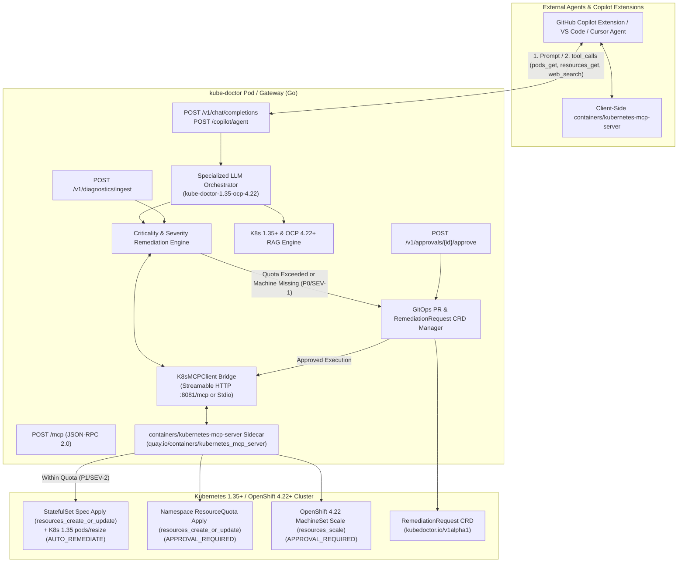

# `kube-doctor` — Specialized LLM & Autonomous Remediation Engine for Kubernetes >= 1.35 & OpenShift >= 4.22

`kube-doctor` (`kube-doctor-1.35-ocp-4.22`) is a specialized LLM gateway, RAG engine, MCP server/client, and severity-driven Kubernetes/OpenShift remediation controller built in Go (with a Python QLoRA fine-tuning pipeline) and natively integrated with **[`containers/kubernetes-mcp-server`](https://github.com/containers/kubernetes-mcp-server)**.

---

## Architecture Overview



---

## Native Integration with `containers/kubernetes-mcp-server`

`kube-doctor` integrates with [`github.com/containers/kubernetes-mcp-server`](https://github.com/containers/kubernetes-mcp-server) in **two ways**:

1. **Direct Backend / Sidecar MCP Client (`internal/mcp/k8s_mcp_client.go`)**:
   - Connects to `kubernetes-mcp-server` over **Streamable HTTP** (`K8S_MCP_SERVER_URL=http://127.0.0.1:8081/mcp`) or **Stdio** (`K8S_MCP_SERVER_COMMAND="npx -y kubernetes-mcp-server@latest"`).
   - Invokes:
     - `pods_get` & `pods_log` (`previous=true`) to inspect `OOMKilled` (`ExitCode 137`) pods.
     - `nodes_stats_summary` to read Kubernetes 1.35+ **cgroup v2 PSI (Pressure Stall Information)** memory pressure telemetry.
     - `resources_get` to inspect `StatefulSet`, `ResourceQuota`, and OpenShift 4.22 `MachineSet` (`machine.openshift.io/v1beta1`) specs.
     - `resources_create_or_update` (Server-Side Apply) to update `StatefulSet` memory requests/limits, create `RemediationRequest` CRDs, and apply approved `ResourceQuota` expansions.
     - `resources_scale` to autoscale OpenShift 4.22 `MachineSet` replicas once approved.
2. **Copilot / IDE Agent Tool-Calling (`internal/llm/engine.go`)**:
   - When an external Copilot Extension, VS Code Copilot Chat, Cursor, or Claude Code agent calls `/v1/chat/completions` with `containers/kubernetes-mcp-server` tools registered (`pods_get`, `pods_log`, `pods_top`, `events_list`, `nodes_stats_summary`, `resources_get`, `resources_create_or_update`, `resources_scale`), `kube-doctor` emits standard OpenAI `tool_calls` for those exact tools alongside web search tools, then consumes the agent's `role: "tool"` output on the next turn.

---

## Core Remediation Workflows

1. **Pod `OOMKilled` (`ExitCode 137`) Managed by `StatefulSet` (Within Namespace Quota)**:
   - **Classification**: `Criticality: P1-HIGH`, `Severity: SEV-2`, `Policy: AUTO_REMEDIATE`.
   - **Action**: Calls `pods_get`, `pods_log`, and `resources_get` on `kubernetes-mcp-server`, then autonomously applies the +50% memory bump via `resources_create_or_update` AND invokes the **Kubernetes 1.35+ GA In-Place Pod Vertical Scaling (`pods/resize`)** subresource.
2. **Namespace `ResourceQuota` Exceeded**:
   - **Classification**: `Criticality: P0-CRITICAL`, `Severity: SEV-1`, `Policy: APPROVAL_REQUIRED`.
   - **Action**: Creates a `RemediationRequest` CRD (`kubedoctor.io/v1alpha1`) via `resources_create_or_update` and opens a **GitOps Pull Request** to expand the Namespace `ResourceQuota`, chaining the `StatefulSet` memory bump as an automatic follow-up action once approved (`POST /v1/approvals/{id}/approve`).
3. **Missing / Failed Machine in OpenShift 4.22+ (`MachineSet` Autoscaling)**:
   - **Classification**: `Criticality: P0-CRITICAL`, `Severity: SEV-1`, `Policy: APPROVAL_REQUIRED`.
   - **Action**: Creates a `RemediationRequest` CRD and opens a **GitOps Pull Request** to scale the OpenShift `MachineSet` (`machine.openshift.io/v1beta1`) in `openshift-machine-api` via `resources_scale` upon human approval.

---

## Quick Start

### 1. Run with `containers/kubernetes-mcp-server`
```bash
# Option A: Streamable HTTP mode
kubernetes-mcp-server --config deploy/mcp-config.toml &
export K8S_MCP_SERVER_URL="http://127.0.0.1:8081/mcp"
go run ./cmd/kube-doctor

# Option B: Stdio mode via npx
export K8S_MCP_SERVER_COMMAND="npx -y kubernetes-mcp-server@latest"
go run ./cmd/kube-doctor
```

### 2. Generate Fine-Tuning Dataset & Train QLoRA Adapter
```bash
python3 training/dataset_generator.py
axolotl train training/qlora_config.yaml
```
