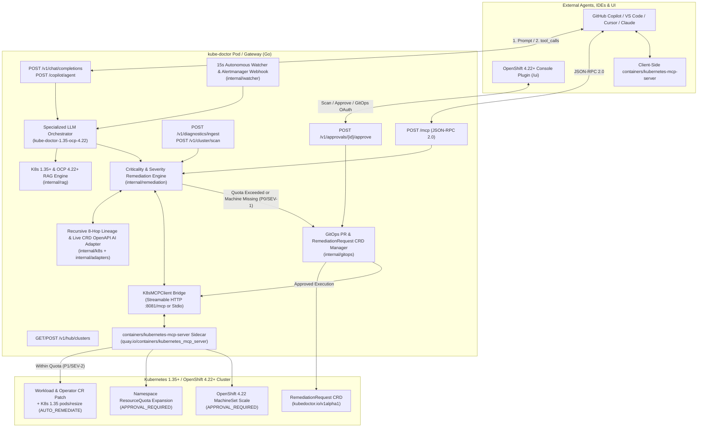

# `cmd/kube-doctor` — System Architecture Overview

This document describes the architecture and component wiring of the `kube-doctor` binary ([`cmd/kube-doctor/main.go`](cmd/kube-doctor/main.go)).

---

## Architecture Diagram

---

## Internal Package Map

| Package | Path | Responsibility |
| :--- | :--- | :--- |
| `main` | [`cmd/kube-doctor/main.go`](cmd/kube-doctor/main.go) | Single-binary entrypoint supporting `--mode=standalone\|hub\|agent` |
| `api` | [`internal/api/`](internal/api/server.go) | HTTP gateway (`/v1/chat/completions`, `/copilot/agent`, `/mcp`, `/ui`, `/v1/cluster/scan`, `/v1/incidents`, `/v1/approvals`, `/v1/hub/*`, `/v1/gitops/*`) |
| `k8s` | [`internal/k8s/`](internal/k8s/client.go) | K8s 1.35+ / OCP 4.22+ REST client, live cluster scanner, 8-hop `ownerReferences` lineage walker, and live CRD OpenAPI v3 schema inspector |
| `adapters` | [`internal/adapters/`](internal/adapters/registry.go) | Universal AI + CRD OpenAPI v3 Schema Operator Adapter and optional YAML hints (`configs/adapters/`) |
| `remediation` | [`internal/remediation/`](internal/remediation/engine.go) | Criticality/Severity triage (`P0-CRITICAL`/`SEV-1` vs `P1-HIGH`/`SEV-2`) and `AUTO_REMEDIATE` vs `APPROVAL_REQUIRED` execution engine |
| `gitops` | [`internal/gitops/`](internal/gitops/manager.go) | `RemediationRequest` CRD (`kubedoctor.io/v1alpha1`) lifecycle, GitHub PR / GitLab MR creation, OAuth flows, and SCM webhooks |
| `watcher` | [`internal/watcher/`](internal/watcher/watcher.go) | 15-second autonomous reconciliation loop, Alertmanager v4 webhook receiver, and Post-Remediation Effectiveness Monitor |
| `hub` | [`internal/hub/`](internal/hub/manager.go) | Multi-Cluster Hub & Spoke Agent fleet manager, heartbeat ingestion, and per-cluster command queues |
| `operator` | [`internal/operator/`](internal/operator/controller.go) | OpenShift Operator reconciler for `KubeDoctor` and `RemediationRequest` CRs |
| `llm` | [`internal/llm/`](internal/llm/engine.go) | Specialized LLM orchestrator (`kube-doctor-1.35-ocp-4.22` via Ollama/vLLM + RAG + MCP tool-calling) |
| `rag` | [`internal/rag/`](internal/rag/engine.go) | Kubernetes `>= 1.35` & OpenShift `>= 4.22` runbook retrieval engine |
| `mcp` | [`internal/mcp/`](internal/mcp/README.md) | JSON-RPC 2.0 / Streamable HTTP MCP server (`/mcp`) and client bridge to `containers/kubernetes-mcp-server` |
